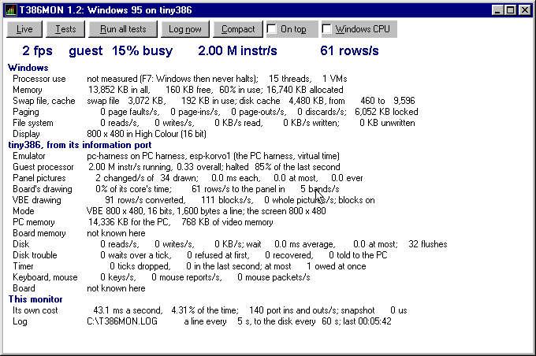
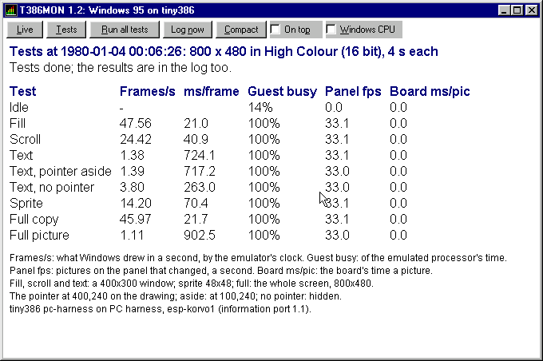

# T386Mon ⚙️

[](https://github.com/platima/T386Mon/actions/workflows/ci.yml)
[](https://github.com/platima/T386Mon/actions/workflows/release.yml)
[](https://github.com/platima/T386Mon/releases/latest)
[](LICENSE)

T386MON is a performance monitor and benchmark for Windows 95 running on [tiny386](https://github.com/hchunhui/tiny386), the little x86 PC emulator. It's one small window that shows Windows' own figures next to the emulator's - the panel's frames a second, how busy the emulated processor is, how fast it runs, the drawing, the disk, the timer - read straight out of tiny386 through an information port. It also runs a set of drawing tests and keeps a log you can copy off the disk image afterwards.

I wanted it because Windows 95 on tiny386 has no Task Manager, and I wanted to know where the time goes when Windows runs on an ESP32-S31 at the panel's 800x480. It works with less on any other Windows 95 PC too: without the port it says it isn't running on tiny386, shows Windows' own figures, and times the tests by Windows' clock.

<p align="center">
  
</p>

<sub>The live view in Windows 95 OSR2 at 800x480 in 16 bits, on the PC harness (the board firmware's emulator core run on a PC, at the board's 2 million instructions a second). Pictures from the board to come.</sub>

## Table of Contents
- [What it does](#what-it-does-)
- [Which tiny386 has the port](#which-tiny386-has-the-port-)
- [Getting it into Windows](#getting-it-into-windows-)
- [The window](#the-window-)
- [The benchmark](#the-benchmark-)
- [The log](#the-log-)
- [Switches](#switches-)
- [What it costs](#what-it-costs-)
- [The information port](#the-information-port-)
- [Building from source](#building-from-source-)
- [Layout](#layout-)
- [Sponsor This Project](#sponsor-this-project-)
- [Acknowledgements](#acknowledgements-)
- [Licence](#licence-)
- [Author](#author-)

## What it does ✨

- **One 48 KB program** - `T386MON.EXE`, no installer, no DLLs beyond the four Windows 95 already has (KERNEL32, USER32, GDI32, ADVAPI32). It installs nothing and changes nothing in Windows.
- **Made for the machine tiny386 emulates** - integer code for a 386 with no FPU (tiny386 runs Windows with `fpu = 0`), calling only functions Windows 95 OSR2 has. The build checks both, every time.
- **Live figures once a second** - the panel's fps, the guest's processor load, million instructions a second and rows sent to the panel; then memory, the swap file, paging, the file system and the display mode from Windows; and the drawing, disk, timer, keyboard and mouse from tiny386.
- **A benchmark** - nine drawing tests of 4 seconds each (fill, scroll, text three ways, a sprite, two full screen tests), with the mouse pointer parked where each test says, timed by the emulator's own clock when there is one.
- **A log** - `C:\T386MON.LOG`, a line every 5 seconds plus every test's results, written to the disk once a minute so it stays out of the tests' way.
- **Cheap to run** - about 6% of the guest at 800x480 in 16 bits in the live view, less in the compact view, about 1% minimised (PC harness figures).

So far it has run in Windows 95 OSR2 on the PC harness at 640x480 in 16 colours, at 800x480 in 8, 16, 24 and 32 bits, and at the DOS board's 800x600. I'm trying it on the ESP32-S31-Korvo-1 with firmware v4.3 now.

## Which tiny386 has the port 🧩

The emulator's figures come from an information port, eight I/O ports at 0F1F8h to 0F1FFh, which only tiny386 builds that have it answer:

| tiny386 | Information port | What T386MON shows |
|-|-|-|
| My bare-metal ESP32-S31 firmware, **v4.3 and later** | 1.1 | everything |
| My bare-metal ESP32-S31 firmware, v4.2 and earlier | none | Windows' figures, tests by Windows' clock |
| Upstream [tiny386](https://github.com/hchunhui/tiny386) | none yet | Windows' figures, tests by Windows' clock |
| Any other PC or emulator running Windows 95 | none | Windows' figures, tests by Windows' clock |

Without the port the emulator's lines say "not running on tiny386 (no information port: ffffffff at F1FCh)", and the top line shows Windows' own processor figure and free memory instead.

## Getting it into Windows 💾

Grab `t386mon.img` (a 1.44 MB floppy image with `T386MON.EXE` and a short `README.TXT`), or `T386MON.EXE` on its own, from the [latest release](https://github.com/platima/T386Mon/releases/latest).

### On tiny386 bare metal on the ESP32-S31

Copy `t386mon.img` into the card's `tiny386` folder, next to the ini that starts Windows, and add one line under `[pc]` in that ini:

```ini
[pc]
; ... the lines already there (bios, mem_size, hda and so on) ...
fda = t386mon.img
```

Start Windows from the boot menu as usual, then Start, Run, `A:\T386MON.EXE`. The floppy's boot sector hands the start on to the hard disk, so Windows boots normally with it in A:.

If A: is already busy with `vbe-reg.img` (as when installing the display driver), put T386MON in B: instead:

```ini
fda = vbe-reg.img
fdb = t386mon.img
```

and run `B:\T386MON.EXE`. B: needs something in A: - with `fdb` on its own, Windows says it can't find the file.

To keep it, copy `T386MON.EXE` to `C:\` in Explorer, make a shortcut, and take the floppy lines back out of the ini. Starting it takes some seconds of the guest's time (12 to 25 seconds on the PC harness).

### On any other Windows 95 PC

Copy `T386MON.EXE` over however you like and run it. Two things to know:

- To find the port it writes to I/O port 0F1F8h and reads 0F1FCh. On tiny386 that's harmless, but on a real PC an old ISA card that only decodes ten address bits would see it as 01F8h. If that worries you, start it with `/noport` and it won't look at all.
- It's made for Windows 95. On Windows NT it doesn't look for the port, as NT won't let a program reach I/O ports itself; beyond that it hasn't been tried there, or on Windows 98 or Me.

## The window 🪟

Buttons along the top, each with a key that works wherever the focus is:

| Button | Key | What it does |
|-|-|-|
| Live | F2, Alt+L | the figures, once a second |
| Tests | F3, Alt+T | the tests' results table |
| Run all tests | F5, Alt+R | runs the benchmark; **Esc** stops it |
| Log now | F6, Alt+N | writes the whole live view into the log, straight away |
| Compact | F4, Alt+C | two lines in a small window on top of the others; double-click it (or F4) to come back |
| On top | Alt+P | keeps the full window on top too |
| Windows CPU | F7, Alt+W | turns Windows' own processor figure on or off (see below) |

### The top line

| Figure | What it means |
|-|-|
| **N fps** | the panel's frames a second: of the pictures the board drew in the last second (it draws one every 30 ms whether anything changed or not), the ones in which something changed. A still desktop shows 1 to 3 fps, T386MON's own changing numbers among them. |
| **guest N% busy** | how much of the last second the emulated processor wasn't halted - the guest's processor load, as a task manager would show it |
| **N M instr/s** | million guest instructions a second while running, halted time left out, as the board's Ctrl+Alt+F12 speed screen shows it |
| **N rows/s** | rows sent to the panel a second - how much of the screen is changing |

"Busy" relies on Windows halting when it has nothing to do, which it does at an idle desktop. A DOS box, or a program that polls, keeps the guest busy even when the screen looks idle. "M instr/s" counts a whole `rep` string instruction (a block fill or copy) as one, as the speed screen does, so it drops during big fills and copies.

### The rest of the figures

**Windows**, from Windows 95's own performance data (what System Monitor reads) and `GlobalMemoryStatus`:

| Line | What it shows |
|-|-|
| Processor use | Windows' own figure when it's on; threads; virtual machines (one, plus one for each DOS box) |
| Memory | physical memory in all and free, Windows' memory load, memory allocated |
| Swap file, cache | the swap file's size and how much is in use; the disk cache's size and its limits |
| Paging | page faults, page-ins, page-outs and discards a second; locked memory |
| File system | reads and writes a second, KB a second each way, data not yet written |
| Display | the mode Windows is drawing in |

**tiny386**, from the information port:

| Line | What it shows |
|-|-|
| Emulator | the firmware and the board, or why there's no port |
| Guest processor | million instructions a second while running and overall, and the per cent halted |
| Panel pictures | the pictures of the last second that changed, of those drawn; on the board the average and longest time a picture took to draw, and the longest ever |
| Board's drawing | the share of the drawing core's time spent drawing; rows to the panel a second and the bands they went in |
| VBE drawing | rows converted from the blocks Windows wrote, the blocks, whole pictures a second, and whether `vbe_blocks` is on |
| Mode | the mode the emulated VGA is in, and the screen it's shown on |
| PC memory | the guest's memory and video memory |
| Board memory | PSRAM and internal RAM free, and their largest free blocks (board only) |
| Disk | the emulator's disk reads and writes a second, KB a second, the average and longest wait, flushes to the card |
| Disk trouble | waits longer than a timer tick, accesses the card refused, recovered, errors passed on to the guest |
| Timer | timer ticks dropped, all and in the last second; the most owed at once |
| Keyboard, mouse | key events, mouse reports and mouse packets a second |
| Board | processor clock, minutes up, the status LED's code, log lines held back and dropped (board only) |

**This monitor**: what T386MON's own once-a-second work cost the guest, its port reads and writes a second, what a snapshot cost the emulator, and where the log is going.

### Windows' own processor figure

Windows 95 only measures its processor use while a program asks it to, and while it does, its idle loop spins instead of halting. On tiny386 that makes the emulator see the guest 100% busy all the time, and Windows' own figure reads low anyway (0 to 2% on a desktop the emulator measured at 17 to 20% busy). So with the port, Windows' figure is off unless you press F7 or start with `/wcpu`, and the emulator's figure is the one on the top line. Without the port it's on by default (`/nowcpu` turns it off). It's always off while the tests run.

## The benchmark 🏁

<p align="center">
  
</p>

<sub>The tests' table at 800x480 in 16 bits with VMDisp9x as released, on the PC harness.</sub>

Press **F5** (Run all tests) and leave the mouse alone until the status line says "Tests done" - about 80 seconds of the guest's time. T386MON parks the mouse pointer for the tests and puts it back after. Maximise the window for the biggest text if you want to photograph the table.

| Test | One frame | The pointer |
|-|-|-|
| Idle | nothing: what Windows and the emulator do with nothing to draw | at the centre |
| Fill | a 400x300 window filled with one solid colour (`PatBlt`), a new colour each frame | on the drawing |
| Scroll | the window moved up 4 pixels on the screen itself (`BitBlt` screen to screen), a band drawn at the bottom | on the drawing |
| Text | 24 lines of 60-odd characters in the dialog font, opaque, new colours each frame (`ExtTextOut`) | on the drawing |
| Text, pointer aside | the same | beside the drawing |
| Text, no pointer | the same | hidden |
| Sprite | a 48x48 ball moved 4 pixels with a mask, as a game does (`PatBlt`, then `BitBlt` SRCAND and SRCPAINT) | on the drawing |
| Full copy | the whole screen copied from a picture in memory of the screen's own format, shifted 8 pixels | on the drawing |
| Full picture | the whole screen from an 8-bit picture whose 256 colours change every frame, so Windows matches every colour again each time - a worst case | on the drawing |

Before each test T386MON waits for things to go quiet: at least a second, and with the port until the guest has been at least half halted for a whole second and the disks have been idle for 2.5 seconds (the board flushes the card 2 seconds after the last write), 10 seconds at most.

The table has frames a second, ms a frame, how busy the guest was, the panel's fps during the test and the board's average time to draw a picture. A mark after the frames a second means `*` stopped with Esc, `m` the mouse moved during the test, or `c` the emulator's clock and Windows' disagreed by more than 1% (or timer ticks were dropped). Without the port the table shows Mpixels a second in place of the emulator's columns.

`T386MON /bench` runs the tests by itself 3 seconds after it starts, and `/bench /quit` closes when they're done.

Frames a second are by the emulator's clock when the port is there, which on the board is real time. On the PC harness that clock counts guest instructions, and the harness counts a whole `rep` string as one instruction, so harness results compare drivers and modes by the guest's work, not by what the board will manage.

## The log 📜

`C:\T386MON.LOG`, plain text with DOS line ends, added to on each start. Each run begins with a few `#` lines (the version, Windows' build, the screen mode, memory, the port and the firmware), then a line every 5 seconds, each the average over its 5 seconds:

| Column | What it is |
|-|-|
| `time`, `up_s` | Windows' time of day; seconds since Windows started (go by this one - the board's clock starts at 1980) |
| `wcpu` | Windows' own processor figure, or `-` when it's off |
| `gbusy` | the guest's processor load, per cent |
| `mips`, `mips_all` | million guest instructions a second, running and overall |
| `fps`, `refr/s` | pictures that changed a second, and all pictures drawn a second |
| `draw_ms`, `max_ms` | the board's average time a picture, and the longest |
| `bload` | per cent of the drawing core's time spent drawing |
| `rows/s`, `vbe_rows/s`, `whole/s` | rows to the panel, rows converted from VBE blocks, whole VBE pictures, a second |
| `free_kb`, `swap_kb` | physical memory free, swap file in use |
| `pf/s` | page faults a second |
| `fs_rd/s`, `fs_wr/s`, `fs_rkb/s`, `fs_wkb/s` | Windows' file system: reads, writes, KB read and written, a second |
| `dk_rd/s`, `dk_wr/s`, `dk_kb/s`, `dk_wait_ms` | the emulator's disk: reads, writes, KB a second, the average wait |
| `flush` | flushes to the card in the interval |
| `tdrop` | timer ticks dropped in the interval |
| `keys/s`, `mouse/s` | key events and mouse reports a second |
| `cost_ms` | T386MON's own time, ms a second |

The emulator's columns are `-` without the port. A run of the tests adds a block with a line for each test and a one-line summary, and Log now (F6) adds the whole live view as `#` lines.

The lines wait in memory and go to the disk every 60 seconds, at Log now, after the tests, and when T386MON closes or Windows shuts down with it open - never during a test. On the board every write to the disk image is followed by a flush to the card, which holds the guest up for a moment, so once a minute keeps those rare. **Close T386MON or shut Windows down before turning the board off**, so the last lines get written.

To read it on a PC, take a copy of the disk image off the card. With mtools, for an image whose partition starts at sector 63 (as the Windows 95 images I use do):

```sh
mcopy -i win95.img@@32256 ::/T386MON.LOG .
```

## Switches ⌨️

`T386MON [/bench] [/quit] [/secs:N] [/every:N] [/write:N] [/nolog] [/log:PATH] [/refresh:N] [/compact] [/top] [/wcpu] [/nowcpu]`, and `/?` lists them.

| Switch | What it does |
|-|-|
| `/bench` | runs the tests 3 seconds after the start |
| `/quit` | closes when the tests are done |
| `/secs:N` | seconds a test (4; 1 to 60) |
| `/every:N` | a log line every N seconds (5); `/every:0` or `/nolog` for none, only the tests and Log now |
| `/write:N` | the waiting log lines written to the disk every N seconds (60); 0 for straight away (never during the tests) |
| `/log:PATH` | the log file (`C:\T386MON.LOG`) |
| `/refresh:N` | the live view drawn every N seconds (1); the log keeps its own interval |
| `/compact`, `/top` | start compact, or on top |
| `/wcpu`, `/nowcpu` | Windows' own processor figure on or off |

And for digging deeper: `/debug` writes each second's cost in parts into the log, `/calib` times each kind of drawing call with the pointer in four places, `/direct` and `/buffer` choose how the window is drawn, and `/noport` and `/nostats` leave out the port or Windows' performance data.

## What it costs 💸

Drawing on the screen is what costs on this machine, so the live view only redraws the numbers that changed, and picks the cheaper of drawing straight to the screen or into a copy in memory put on the screen once a second (it times both when it starts). Windows' slower figures are read every 5 seconds and the port once a second.

T386MON's own share of the guest, measured on the PC harness at 2 million instructions a second:

| View | VMDisp9x, 800x480 in 16 bits | Standard VGA, 640x480 in 16 colours |
|-|-|-|
| Live | about 6% | about 4% |
| Compact | about 4% | about 2% |
| Tests view, or minimised | about 1.3% | about 1.4% |

What it costs on the board is one of the things the board will tell us; the "This monitor" line shows it live.

## The information port 🔌

The port is a small, versioned interface I added to the bare-metal tiny386 firmware: write an index, read a 32-bit value. One command takes a snapshot so that values read one after another belong together, and reads change nothing in the emulator or the guest. It's version 1.1, with 128 indexes covering the emulator's identity and clocks, the guest's instructions and halts, every picture the board draws, the display mode, memory, the disks, the timer, the keyboard and mouse, and the firmware and board names.

- [`PROTOCOL.md`](PROTOCOL.md) says what every value means and how to read it, from DOS, a DOS box or a Win32 program.
- [`perfport.h`](perfport.h) is the protocol as a plain C89 header, the same file as the firmware's own copy. It's all a guest program needs, 16-bit or 32-bit.
- [`port-test/`](port-test/) has the source of PPTEST.COM, a DOS program that reads every value with every width of `in` and `out`, and its checker.

Any program inside the emulated PC can use it, so if you write something else that reads it, I'd love to hear about it.

## Building from source 🛠️

T386MON is one C file built with GCC for `i686-w64-mingw32` and no C library at all (Windows 95 has no `MSVCRT.DLL`), so it carries its own few helpers. You need Debian 12 (bookworm), in WSL or not, with:

```sh
sudo apt-get install gcc-mingw-w64-i686-win32 binutils-mingw-w64-i686 mingw-w64-i686-dev mtools python3 binutils
bash build.sh            # T386MON.EXE and t386mon.img in ./out
bash port-test/build.sh  # PPTEST.COM in ./out
```

After the link, `build.sh` checks the program and stops if either check fails:

- `src/pecheck.py` - a PE that Windows 95 loads (OS and subsystem version 4.0, no TLS or the like), importing only the 89 functions in `src/w95imports.txt`, each of them checked against Windows 95 OSR2's own DLLs.
- `src/cpucheck.py` - 386 integer instructions only: no x87 (tiny386 runs Windows with `fpu = 0`), no MMX or SSE, nothing the 486 or later added.

The build is reproducible: the same toolchain gives the same `T386MON.EXE` and `t386mon.img`, byte for byte, whichever folder it runs in. GitHub Actions builds both on every push, in a Debian 12 container with the toolchain's versions pinned, builds them a second time to prove they come out the same, and a version tag cuts a release with `SHA256SUMS`.

## Layout 📁

```
build.sh            builds T386MON.EXE and t386mon.img, with the checks
perfport.h          the information port's protocol, shared with the firmware
PROTOCOL.md         what every value means and how to read it
src/
  t386mon.c         the program, one file
  t386mon.rc        its version information (mkicon.py draws its icon)
  pecheck.py        the Windows 95 loader and import check
  cpucheck.py       the 386 with no FPU instruction check
  w95imports.txt    the functions it may import
  README.TXT        the floppy's short guide
port-test/          PPTEST.COM, a DOS test of the port, and its checker
docs/images/        the pictures in this README
.github/workflows/  CI on every push, and the release on a tag
```

## Sponsor This Project 💝

If T386MON saved you some time, or you just like seeing Windows 95 on odd hardware, you can chip in:

**[💖 Sponsor on GitHub](https://github.com/sponsors/platima)**

## Acknowledgements 🙏

- [tiny386](https://github.com/hchunhui/tiny386) by hchunhui - the emulator all of this runs on, and the reason a 386 PC fits on an ESP32 at all.
- [mingw-w64](https://www.mingw-w64.org/), [GCC](https://gcc.gnu.org/) and [GNU binutils](https://www.gnu.org/software/binutils/) - the toolchain that builds it, as Debian packages it.
- [GNU mtools](https://www.gnu.org/software/mtools/) - for making the floppy image without mounting anything.
- [VMDisp9x](https://github.com/JHRobotics/vmdisp9x) by JHRobotics - the display driver that gets Windows 95 to 800x480 on the board, and much of what the tests measure.

## Licence 📄

- My own work here is MIT - see [LICENSE](LICENSE).
- `port-test/pptest.S` and `port-test/bios.inc` say in their headers that they're offered under tiny386's licence (BSD 3-clause), as they were written alongside it.
- Windows 95 is Microsoft's. Nothing of it is in this repo or its releases - bring your own.

## Author 👨‍💻

**Platima** - [GitHub Profile](https://github.com/platima)
